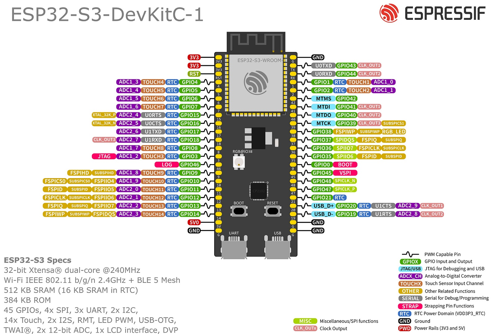

# Microcontroller based predictive-maintenance system
An STM32 running FreeRTOS samples vibration, sound and environmental data.
An ESP32-S3 shows a live dashboard and publishes data.

`Work in progress`
## Pinout

Reference diagrams: [Black Pill](docs/blackpill-pinout.png) ([PDF](docs/blackpill-pin-layout.pdf), from WeAct Studio) · [ESP32-S3-DevKitC-1](docs/esp32s3-devkitc1-pinout.jpg) (from Espressif, board v1.1)

### STM32F401CCU6 (Black Pill)

| Pin | Function | Connection |
| --- | --- | --- |
| PC13 | GPIO out | On-board LED (active low) |
| PA13 / PA14 | SWDIO / SWCLK | ST-LINK (Nucleo, reserved) |
| PA2 / PA3 | USART2 TX / RX | USB-UART (debug, 115200) |
| PA9 / PA10 | USART1 TX / RX | ESP32 GPIO18 / GPIO17 (cross TX→RX) |
| PB6 / PB7 | I2C1 SCL / SDA | MPU6050, AHT20, BMP280 (4.7 kΩ pull-ups) |
| PB0 | EXTI | MPU6050 INT (data-ready / wake) |
| PA5 / PA6 / PA7 | SPI1 SCK / MISO / MOSI | microSD |
| PA4 | GPIO out | microSD CS |
| PB10 / PB12 / PB15 | I2S2 CK / WS / SD | INMP441 SCK / WS / SD (VDD→3V3, GND→GND, L/R→GND) |

### ESP32-S3 N16R8

| ` |   |   |
| --- | --- | --- |
| 48 | RMT | On-board WS2812 LED (GPIO38 on DevKitC-1 v1.1) |
| 17 / 18 | UART1 TX / RX | STM32 PA10 / PA9 |
| 12 / 11 / 13 | SPI2 SCLK / MOSI / MISO | ILI9341 |
| 10 / 9 / 8 | CS / DC / RST | ILI9341 |
| 14 | GPIO / PWM | ILI9341 backlight |
